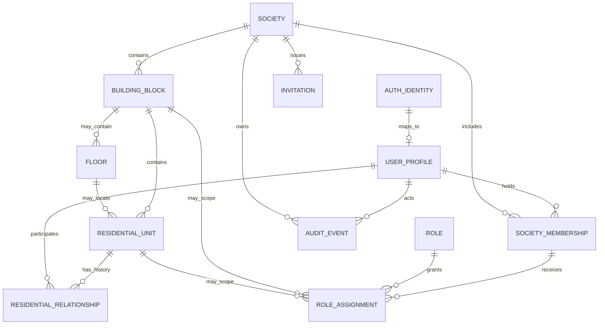

# Preliminary Database Design

## Status

This approved Phase 00 baseline defines a preliminary relational model and data-ownership strategy. It is not a migration specification. Phase 03 will finalise approved names, columns, constraints, policies, and migrations after the hierarchy, role, occupancy, retention, and financial decisions required for that phase are approved.

## Design principles

- One PostgreSQL database with strong multi-tenant isolation.
- UUID primary keys where appropriate.
- Explicit society ownership on tenant data, including lower-scope records where useful for integrity and filtering.
- Tenant-aware composite foreign keys to reject cross-society relationships.
- Application permissions in NestJS and RLS as defence in depth.
- Restricted runtime role without `BYPASSRLS`; separate migration credentials.
- Version-controlled SQL migrations are authoritative.
- Historical records are preserved with lifecycle and effective-period fields.
- Exact monetary values, transactional updates, idempotent commands, and immutable financial history.
- UTC timestamps for storage with an approved society timezone for presentation and scheduling.

## Conceptual relationship model



`BUILDING_BLOCK` is a placeholder conceptual name. The final building/block/floor hierarchy is an open decision.

## Foundational entities for Phase 03

| Entity | Purpose | Tenant ownership and integrity |
| --- | --- | --- |
| `user_profile` | Application profile mapped to verified identity. | Platform-level identity; tenant access comes through memberships. |
| `society` | Root tenant and lifecycle. | Owns all society-scoped data. |
| `society_membership` | Links a profile to a society with active period and state. | Unique and indexed by society and user under approved membership rules. |
| `building_or_block` | Approved organisational segment. | Contains `society_id`; child references include matching society. |
| `floor` | Optional approved floor grouping. | Contains society and parent scope. |
| `residential_unit` | Flat, house, or other approved residence. | Unique identifier within approved parent and society scope. |
| `residential_relationship` | Time-bounded owner, tenant, or authorised occupant relationship. | Links user/membership and unit within the same society. |
| `occupancy_history` | Historical occupancy facts if separate from relationship history. | Society and unit scoped; effective periods preserved. |
| `role` | Approved role or capability bundle definition. | Platform or society-defined according to approved model. |
| `permission` | Stable action identifier. | Platform catalogue; assignments remain scoped. |
| `role_permission` | Maps role to capabilities. | Versioning or effective rules to be determined. |
| `role_assignment` | Time-bounded role or responsibility for a membership and scope. | Society is mandatory; optional block or unit must match society. |
| `committee_appointment` | Committee title, responsibility, scope, and term. | Same-society membership and scope enforced. |
| `invitation` | One-time onboarding request for a society and proposed relationship. | Token stored hashed; expiry and consumption tracked. |
| `audit_event` | Append-focused sensitive activity history. | Platform or society scope, trusted actor, action, target, and safe metadata. |

Whether occupancy is represented by one relationship table or separate ownership, tenancy, occupant, and occupancy tables is intentionally deferred to Phase 03 design review.

## Later module entity families

The following are planned but must not be created as empty Phase 03 placeholders without an approved need:

- Billing configurations, charge definitions, periods, bills, bill lines, adjustments, and balances.
- Payments, allocations, receipts, reconciliation items, reversals, gateway events, and webhook inbox.
- Expense categories, expenses, approvals, accounts, movements, and attachments.
- Announcements, audiences, publication schedules, notification inbox items, deliveries, preferences, and outbox.
- Complaints, assignments, status history, internal notes, resident responses, attachments, feedback, and escalation.
- Report definitions or export jobs only if persistent records are required.

## Tenant-aware relationship pattern

For society-owned tables, a child should not reference only a globally unique parent ID when a composite relationship can also enforce tenant ownership. Conceptually:

```sql
unique (society_id, id)
foreign key (society_id, block_id)
  references building_or_block (society_id, id)
```

The exact Drizzle and SQL definitions belong to Phase 03. This pattern prevents an application error from linking a unit in Society A to a block in Society B.

## Record lifecycle

### Proposed shared fields

- `id`
- `created_at`, `created_by`
- `updated_at`, `updated_by`
- explicit `status`
- optional `archived_at`, `archived_by`, and `archive_reason`
- `effective_from`, `effective_to` for time-bounded relationships

Not every table needs every field. Database triggers versus application-managed audit columns require an architecture decision.

### Historical policy

- Society, membership, occupancy, committee, financial, complaint, and audit records are not hard-deleted through normal product workflows.
- Identity erasure or anonymisation required by law must preserve financial and security integrity according to an approved retention policy.
- Corrections create superseding or compensating records where an audit trail matters.

## Money and financial integrity

### Proposed representation

- Store INR in signed 64-bit integer paise for arithmetic and totals.
- Store currency code even if initial operation is INR-only when the domain record benefits from explicitness.
- Reject unsupported currency combinations.
- Use deterministic rounding only after an approved billing policy defines it.

### Required constraints

- Unique bill identity by society, residential unit, billing period, and charge context.
- Unique provider transaction or webhook event identity within its provider scope.
- Unique receipt number within the approved numbering scope.
- Allocation totals cannot exceed approved payment or bill amounts except through an explicit adjustment policy.
- Published bills keep the rule inputs and line values needed for historical reproduction.
- Reversal references the original transaction and cannot itself be applied more than once unless policy explicitly permits it.

## Row-level security

### Required design

- Enable and force RLS where appropriate for society-owned application tables.
- Runtime connections use a role that is not a table owner and does not have `BYPASSRLS`.
- Within a transaction, set trusted identity and authorised scope context using a safe transaction-local mechanism.
- Policies validate society ownership and, for narrower access, block, unit, or membership scope.
- Service operations with legitimate broader scope use separately reviewed capabilities, not a user-controlled override.
- Application tables are not exposed through unused public data APIs.

### Pooling safety

- Never use persistent session variables that may survive across requests.
- Start a transaction before setting context.
- Use transaction-local settings and guarantee rollback or commit.
- Test parallel requests for different societies through the real pool configuration.

## Index strategy

Phase 03 will validate indexes against actual queries. Expected starting points include:

- Society identifier first on tenant-scoped lookup and uniqueness indexes.
- User and active-state lookup for memberships and assignments.
- Parent scope and natural identifier for blocks and units.
- Effective period and lifecycle state for current relationships.
- Created time and action for audit queries.
- Partial indexes for active records where query evidence supports them.

Indexes are not added speculatively when write cost outweighs demonstrated value.

## Migrations and environments

- SQL migrations in version control are authoritative and append-only after shared use.
- Drizzle schema and generated migration state must agree with SQL.
- A clean database can apply all migrations in order.
- Roll-forward is preferred for production fixes; rollback feasibility is documented per migration.
- Development, staging, and production databases are separate.
- Seed data is development-only, deterministic, clearly synthetic, and contains no real resident information or fixed production passwords.
- Remote migrations require explicit approval.

## Database verification plan

- Apply migrations to an empty local database and re-run schema checks.
- Verify foreign keys, unique constraints, check constraints, and lifecycle rules.
- Test allowed and denied `SELECT`, `INSERT`, `UPDATE`, and `DELETE` under runtime credentials.
- Attempt cross-society references and cross-block access.
- Test suspended and expired memberships.
- Test connection-pool context isolation under concurrency.
- Verify migration credentials can migrate while runtime credentials cannot alter schema.
- Test financial uniqueness and transaction races when those modules are introduced.
- Compare schema documentation and generated diagram with the migrated database.

## Decisions required before Phase 03

- Building, block, floor, and unit hierarchy.
- Unit identifier and category rules.
- Membership and joint ownership model.
- Occupancy overlap and history rules.
- Role, capability, and committee responsibility representation.
- Required lifecycle and retention periods.
- Runtime connection and RLS context mechanism supported by the selected hosting topology.
- Society timezone and financial-year representation.
