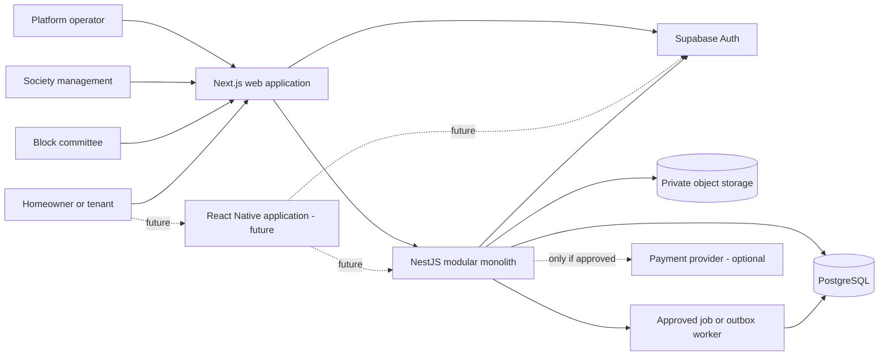

# System Architecture

## Status

This is the Phase 00 target architecture. Technology choices and major boundaries are confirmed by the project brief. Detailed deployment sizing, provider-specific API hosting, and some domain rules remain proposed pending approval.

## Architecture goals

- Strong isolation between societies and finer-grained scopes.
- One source of business truth for web and future mobile clients.
- Independent web and API deployment without premature distributed systems.
- Exact and auditable financial workflows.
- Modular delivery aligned with the phase roadmap.
- Clear contracts, observable failures, and testable boundaries.

## System context



## Confirmed technology direction

| Layer | Technology | Responsibility |
| --- | --- | --- |
| Web | Next.js App Router, React, strict TypeScript | Role-specific responsive interface and server/client rendering. |
| UI | Tailwind CSS, shadcn/ui, Lucide React, Motion, Recharts | Accessible design system, restrained motion, and data visualisation. |
| Forms and server state | React Hook Form, Zod, TanStack Query | Typed validation, forms, caching, and API state. |
| API | NestJS modular monolith | Authentication enforcement, permissions, business workflows, transactions, and REST API. |
| Contracts | OpenAPI plus shared TypeScript validation and client packages | Stable request/response definitions for web and future mobile. |
| Data | PostgreSQL on Supabase, Drizzle ORM | Relational source of truth, constraints, migrations, transactions, and RLS. |
| Identity and files | Supabase Auth and private Supabase Storage | User identity, sessions, and protected attachments. |
| Workspace | pnpm and Turborepo | Monorepo task orchestration and shared configuration. |
| Testing | Vitest, Jest, Playwright, database integration tests | Unit, integration, contract, security, and user journey verification. |
| Delivery | GitHub Actions, Vercel web hosting, approved API host | Controlled CI/CD and separate web/API deployment. |

## Target monorepo

```text
apps/
  web/                    Next.js application
  api/                    NestJS application
  mobile/                 Future React Native application
packages/
  contracts/              Transport schemas and shared public types
  api-client/             Generated or typed REST client
  database/               Drizzle schema, migrations, and database helpers
  config/                 Shared TypeScript and tooling configuration
supabase/
  migrations/             Versioned authoritative SQL migrations
  tests/                  RLS and database security tests
  seed.sql                Development-only seed entry point
docs/
  requirements/
  architecture/
  decisions/
  phases/
  testing/
.github/workflows/
```

Directories are added only when required by an approved phase.

## Application boundaries

### Web application

- Renders role-aware navigation and screens.
- Collects and validates user input for usability, while treating the API as the authority.
- Uses a shared API client and schemas rather than duplicating contracts.
- Keeps server-only tokens and secrets outside browser bundles.
- Does not directly query application tables or make authorisation decisions.
- Displays explicit loading, empty, unavailable, denied, and error states.

### API application

- Validates access tokens and obtains trusted user identity.
- Resolves active society and scoped assignments from server-side records.
- Enforces permissions, invariants, state transitions, idempotency, and transactions.
- Owns application access to PostgreSQL and private object storage.
- Publishes OpenAPI documentation for supported contracts.
- Produces structured logs and audit events without exposing private data.

### PostgreSQL

- Stores authoritative application and audit records.
- Enforces tenant-aware relationships, uniqueness, lifecycle states, and exact financial data.
- Uses RLS as defence in depth under a restricted runtime role without `BYPASSRLS`.
- Receives transaction-local identity and scope context that is reset safely for pooled connections.

### Authentication

- Supabase Auth proves user identity and manages approved session flows.
- Application permissions are not stored only in client-editable identity metadata.
- The API maps verified identity to application profile, memberships, assignments, and account state.

### Object storage

- Attachments remain private by default.
- The API verifies ownership, scope, file policy, and permission before issuing controlled access.
- Metadata in PostgreSQL links each object to its tenant, purpose, uploader, and lifecycle.

## Modular monolith

The NestJS API is one deployable service with domain-focused modules. Initial planned modules are:

- Auth and identities
- Users and profiles
- Societies
- Buildings and blocks
- Units and occupancy
- Committees and scoped permissions
- Maintenance billing
- Payments and expenses
- Announcements and notifications
- Complaints and service requests
- Reports and analytics
- Audit

### Module dependency rules

- Modules expose application services or explicit contracts, not internal repositories.
- Controllers call application services; they do not contain business or persistence logic.
- A module owns writes to its tables. Cross-module operations use services and transactions, not direct table mutation.
- Shared technical utilities belong in narrowly scoped common packages; domain rules remain with their domain.
- Domain events or an outbox coordinate durable side effects where synchronous coupling would risk duplicate or lost work.
- Circular module dependencies are architecture defects and require redesign or a documented decision.

## Request and data flow

### Protected read

1. Client sends an access token and requests a versioned resource.
2. API validates the token and account state.
3. API resolves active memberships and assignments from trusted data.
4. Permission guard evaluates action and resource scope.
5. Service starts a database transaction when tenant context is required.
6. Transaction-local identity and tenant context are set.
7. Tenant-scoped query runs under application predicates, constraints, and RLS.
8. API maps data to an explicit response contract and records safe telemetry.

### Sensitive mutation

1. API authenticates, authorises, validates, and checks lifecycle invariants.
2. An idempotency key is verified for retryable or financial commands.
3. All related writes, balances, audit events, and outbox records occur in one database transaction.
4. Commit succeeds atomically or the operation fails without a partial financial state.
5. External delivery occurs from durable outbox state and can be retried safely.

## Tenant isolation model

Isolation is layered:

1. **Identity:** verified subject maps to an active application profile.
2. **Permission:** server evaluates scoped assignments for the requested action.
3. **Application query:** repositories require society and lower-scope keys.
4. **Relational integrity:** composite keys and foreign keys reject cross-society relationships.
5. **RLS:** database policy checks transaction-local trusted context.
6. **Testing:** allowed and denied operations are exercised for reads, writes, reports, jobs, and exports.
7. **Observability:** denied access and sensitive changes produce safe security or audit signals.

## Background work and notifications

### Proposed direction

- Store announcement and notification intent in PostgreSQL.
- Use a transactional outbox for side effects created by business transactions.
- Process each outbox item with an idempotent consumer and unique delivery key.
- Track attempts, terminal failure, and next retry without duplicating user notifications.
- Keep provider interfaces independent from initial in-app delivery so mobile push can be added later.

The exact job runtime and hosting choice is deferred until the notification phase.

## Financial integrity

- Represent INR as integer paise unless an approved decision selects another exact type.
- Use unique business keys for bill generation, payment references, receipts, and webhook events.
- Keep source transactions and allocations separate from derived balances.
- Recompute or reconcile derived summaries against immutable source records.
- Record corrections as adjustments or reversals with reason and actor.
- Require explicit permissions and audit for configuration, approval, reconciliation, and reversal actions.

## Deployment topology

### Confirmed direction

- Vercel hosts the Next.js web application.
- An approved provider independently hosts the NestJS API.
- Supabase hosts PostgreSQL, Auth, and private Storage.
- Development, staging, and production use separate configuration; staging and production databases are separate.

### Proposed controls

- CI runs formatting checks, lint, type-checking, tests, and builds before release.
- Deploy immutable artefacts and apply migrations through a controlled step with separate credentials.
- Expose API health and readiness checks.
- Use HTTPS only, restrictive CORS, secure cookies where applicable, and environment-specific allowed origins.
- Keep rollback and backward-compatible migration procedures in the operations runbook.

Public deployment, provider purchase, DNS, and production migration remain outside scope until explicit approval.

## Reliability and observability

- Structured JSON logs with request and correlation IDs.
- Redaction of tokens, credentials, payment secrets, and unnecessary personal data.
- Health and readiness signals for API and dependencies.
- Metrics for latency, errors, denied access, job backlog, notification failures, and financial reconciliation exceptions.
- Error monitoring with environment and release identifiers.
- Database backups with documented restore tests and recovery objectives after approval.
- Audit history separate from operational logs.

## Architecture risks

| Risk | Consequence | Planned mitigation |
| --- | --- | --- |
| Missing tenant predicate | Cross-society disclosure or mutation | Scoped repositories, composite constraints, RLS, and denial tests. |
| Privileged runtime database role | RLS silently bypassed | Restricted runtime role; separate migration role; database tests. |
| Connection-pool context leakage | One request inherits another tenant | Transaction-local context, mandatory reset, and concurrency tests. |
| Broad role assumptions | Privilege escalation | Capability checks with explicit scope and delegation rules. |
| Financial retry or race | Duplicate or inconsistent records | Idempotency, unique keys, row locks where justified, and atomic transactions. |
| Cross-module coupling | Slow and unsafe change | Module ownership, application services, contracts, and architecture review. |
| Mock data mistaken as live | Incorrect decisions and loss of trust | Labelled fixtures and explicit unavailable states. |
| Premature distributed architecture | Operational complexity | Modular monolith until measured need supports extraction. |
